# Systems Hardening with Patch Manager via AWS Systems Manager

A hands-on AWS Skill Builder lab walkthrough: using AWS Systems Manager Patch Manager to patch Linux and Windows EC2 instances, build a custom patch baseline, and verify compliance.

## Lab Overview

**Objective:** Use Patch Manager to scan and install OS patches on a mixed fleet of 3 Linux and 3 Windows EC2 instances — using the AWS default baseline for Linux, and a custom baseline for Windows.

**Environment:** AWS Systems Manager, Region `us-west-2` (Oregon). 6 pre-configured EC2 instances (Linux-1/2/3, Windows-1/2/3) already registered as SSM-managed nodes via an attached IAM instance role.

**Skills demonstrated:**
- AWS Systems Manager Fleet Manager (node inventory and management)
- Patch Manager: default baselines, custom baselines, approval rules, patch groups
- On-demand patching with `Patch now` targeting via tags
- Run Command / Association execution tracing
- Compliance reporting and verification

---

## Task 1 — Patch Linux Instances Using the Default Baseline

1. Opened **Systems Manager → Fleet Manager** and confirmed all 6 managed nodes (3 Linux, 3 Windows) were online.

   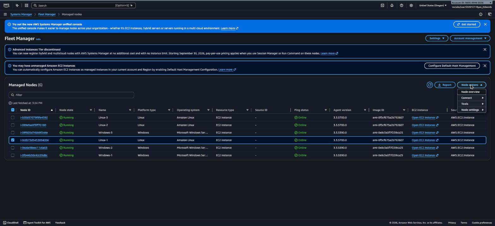

2. Inspected `Linux-1` node details (Platform: Linux / Amazon Linux, IAM role: `RoleForSSM`) to confirm it's manageable via SSM.

   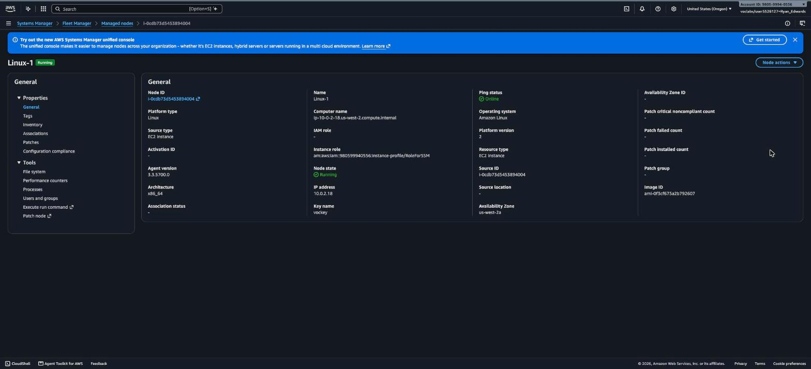

3. In **Patch Manager → Patch now**, configured:
   - Patching operation: **Scan and install**
   - Reboot option: **Reboot if needed**
   - Instances to patch: **Patch only the target instances I specify**
   - Target: tag `Patch Group` = `LinuxProd`

   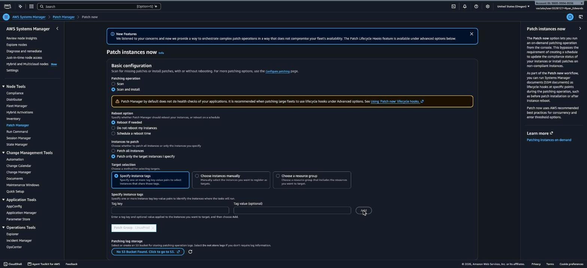

4. Submitted the patch job. Association `AWS-PatchNowAssociation` kicked off targeting `tag:Patch Group:LinuxProd`.

   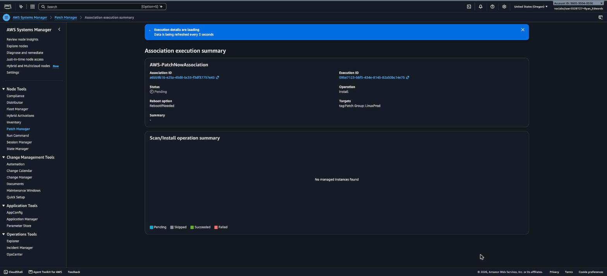

5. **Result:** All 3 Linux instances patched successfully using the AWS default baseline `AWS-AmazonLinux2DefaultPatchBaseline` (no custom baseline needed since Linux instances were pre-tagged `LinuxProd`).

---

## Task 2 — Create a Custom Patch Baseline for Windows

Rather than using the Windows default baseline, I built a custom one with two approval rules.

1. **Patch Manager → Patch baselines → Create patch baseline**
   - Name: `WindowsServerSecurityUpdates`
   - Description: `Windows security baseline patch`
   - Operating system: `Windows`
   - Default patch baseline: left **unchecked**

2. **Rule 1** (critical security patches, fast auto-approval):
   - Products: `WindowsServer2019`
   - Classification: `SecurityUpdates`
   - Severity: `Critical`
   - Auto-approval: 3 days
   - Compliance reporting severity: `Critical`

   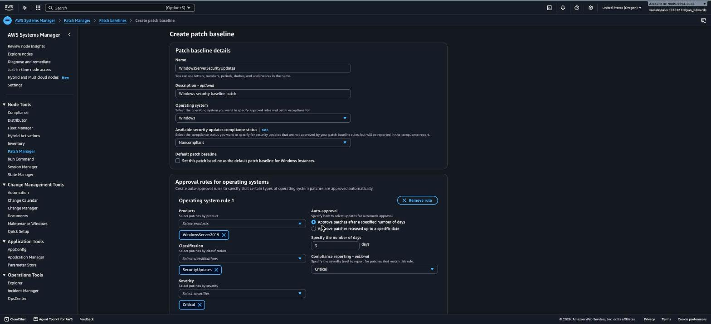

3. **Rule 2** (important security patches):
   - Products: `WindowsServer2019`
   - Classification: `SecurityUpdates`
   - Severity: `Important`
   - Auto-approval: 3 days
   - Compliance reporting severity: `High`

   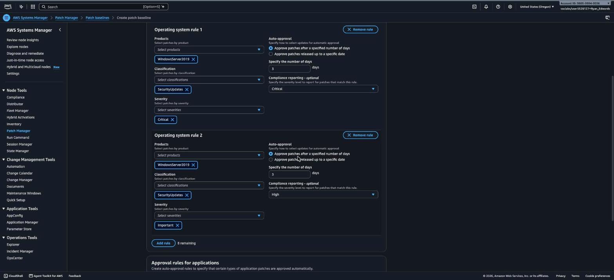

4. Clicked **Create patch baseline** — succeeded.

   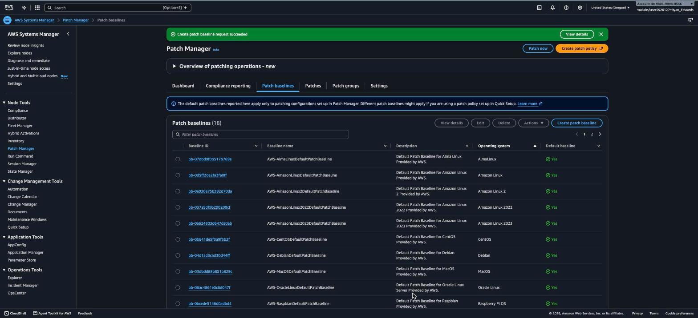

5. Associated the new baseline with a **patch group** so it only applies to tagged instances: selected the baseline → **Actions → Modify patch groups** → added patch group value `WindowsProd`.

   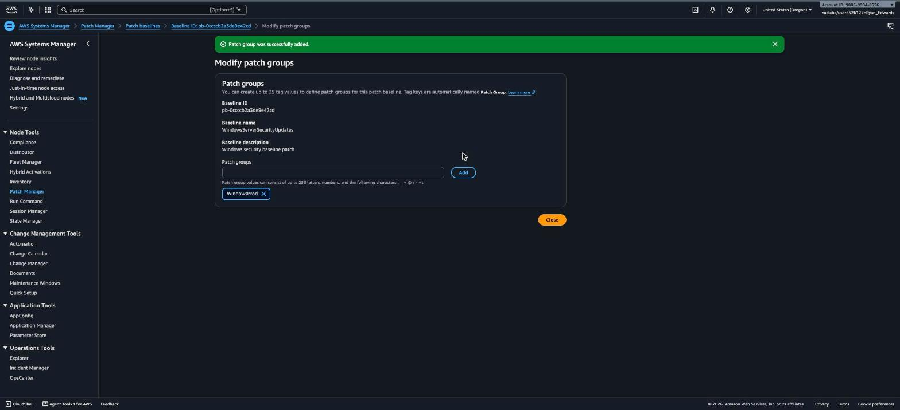

---

## Task 3 — Patch the Windows Instances

### 3.1 Tag the Windows instances

Tagged each Windows instance (`Windows-1`, `Windows-2`, `Windows-3`) individually via **EC2 → Instances → [select instance] → Tags tab → Manage tags**:

- Key: `Patch Group`
- Value: `WindowsProd`

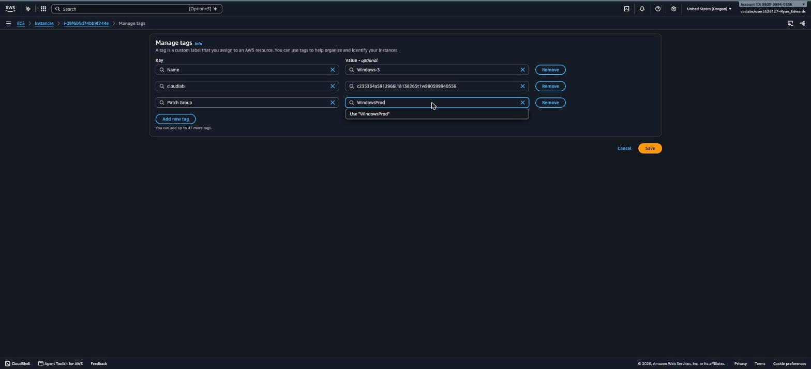

(The Linux instances were already pre-tagged `LinuxProd` during lab setup.)

### 3.2 Patch the Windows instances

In **Patch Manager → Patch now**, configured:
- Patching operation: **Scan and install**
- Reboot option: **Reboot if needed**
- Target: tag `Patch Group` = `WindowsProd`

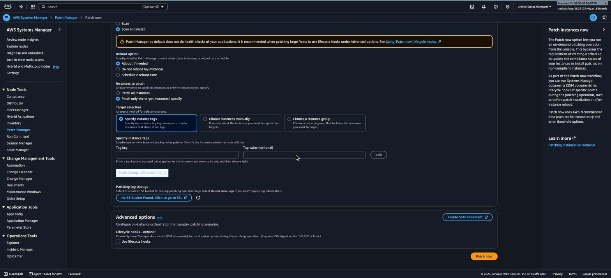

The association triggered Run Command executions of `AWS-RunPatchBaseline`. Watched progress in **Run Command**:

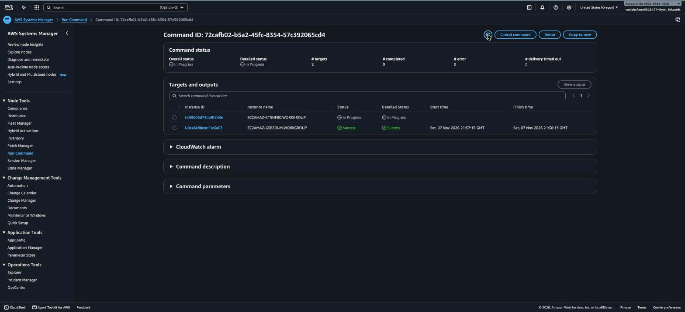

Drilled into a succeeded instance's output — Systems Manager calls `AWS-RunPatchBaseline`, which runs the `PatchWindows` step (via `PatchBaselineOperations`), referencing our custom baseline and the `WindowsProd` patch group:

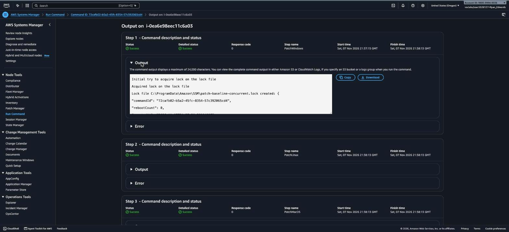

> **Note:** The first "Patch now" submission only picked up 2 of the 3 Windows instances (a brief tag-propagation delay on the newly-tagged third instance). Re-running "Patch now" against the same `Patch Group:WindowsProd` tag a minute later picked up the remaining instance (`Windows-1`) and completed it successfully.

---

## Task 4 — Verify Compliance

1. **Patch Manager → Dashboard**: Compliance summary shows **100% Compliant**, 0 noncompliance counts (missing patches, failed patches, pending reboot, available security updates all at 0).

   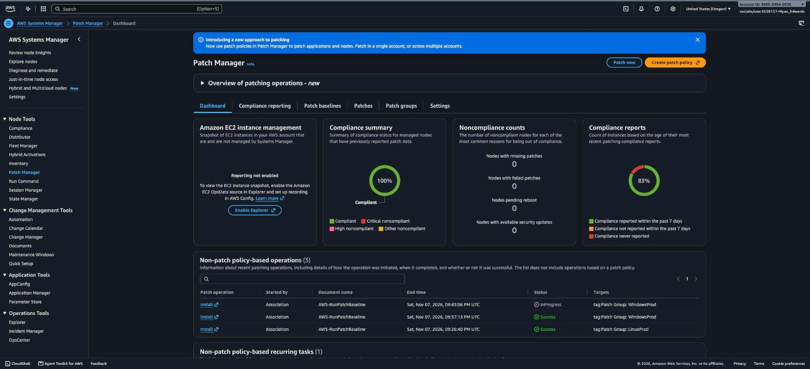

2. **Patch Manager → Compliance reporting**: All 6 nodes (Linux-1/2/3, Windows-1/2/3) report **Compliant**, with 0 critical/security/other noncompliant counts.

   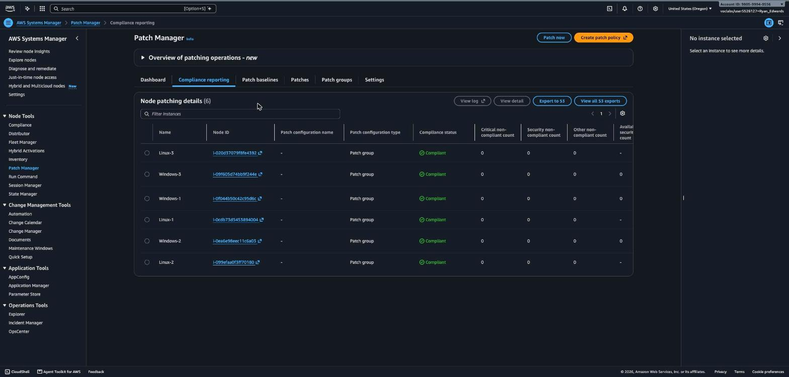

3. Selected `Windows-3` in the compliance table to confirm it used the correct custom baseline and patch group:
   - **Baseline ID used:** `pb-0ccccb2a3de9e42cd` (our `WindowsServerSecurityUpdates` baseline)
   - **Patch group used:** `WindowsProd`
   - **Missing / Failed / Available security updates counts:** all `0`

   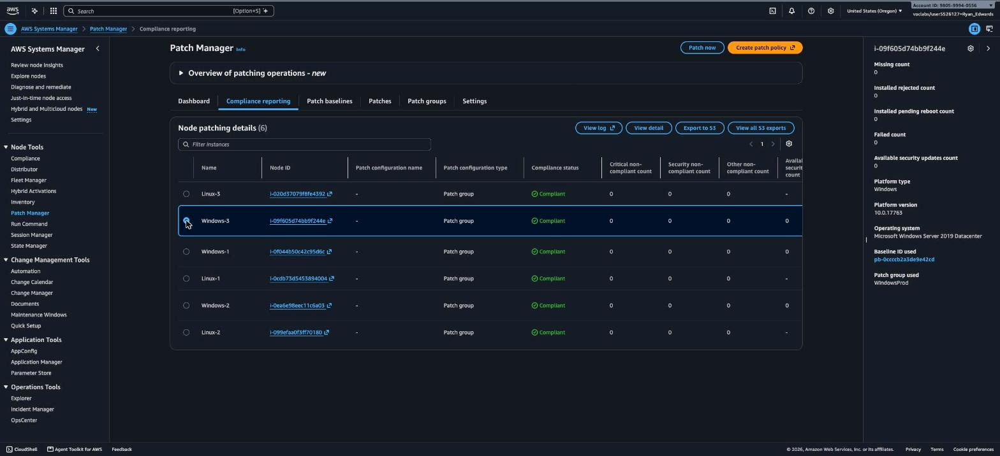

---

## Outcome

- ✅ Patched 3 Linux EC2 instances using the AWS default patch baseline (`AWS-AmazonLinux2DefaultPatchBaseline`), targeted by the `LinuxProd` patch group tag.
- ✅ Created a custom Windows patch baseline (`WindowsServerSecurityUpdates`) with two approval rules (Critical / Important security updates) and attached it to a `WindowsProd` patch group.
- ✅ Tagged all 3 Windows instances with `Patch Group: WindowsProd` and patched them on-demand via Patch Manager's "Patch now," using Run Command (`AWS-RunPatchBaseline`) under the hood.
- ✅ Verified 100% patch compliance across all 6 managed nodes, with the custom baseline and patch group correctly applied to the Windows fleet.

**Key AWS services/features used:** AWS Systems Manager (Fleet Manager, Patch Manager, Run Command, State Manager associations), EC2 instance tagging, IAM instance roles for SSM management.
