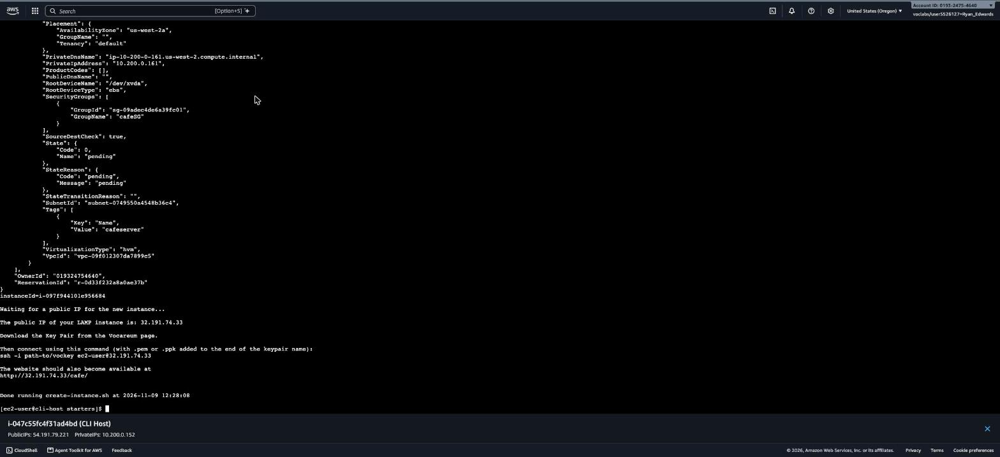
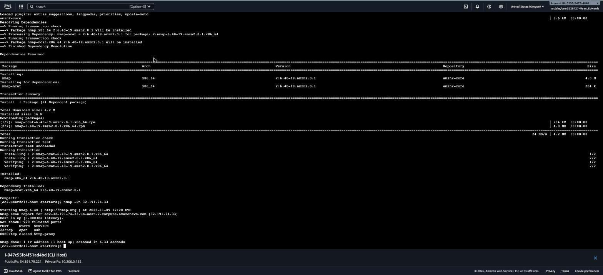
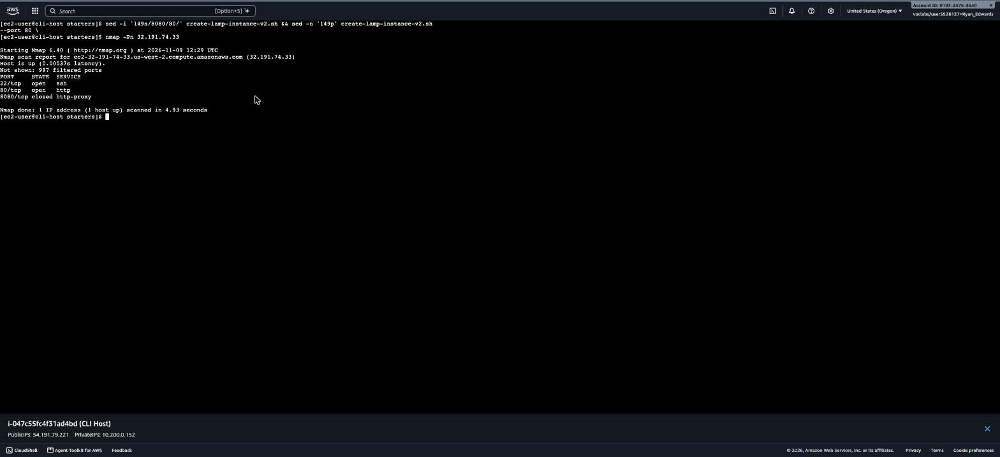
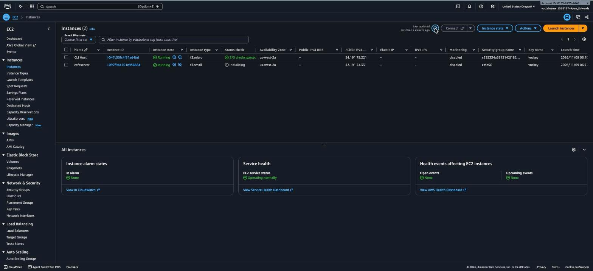
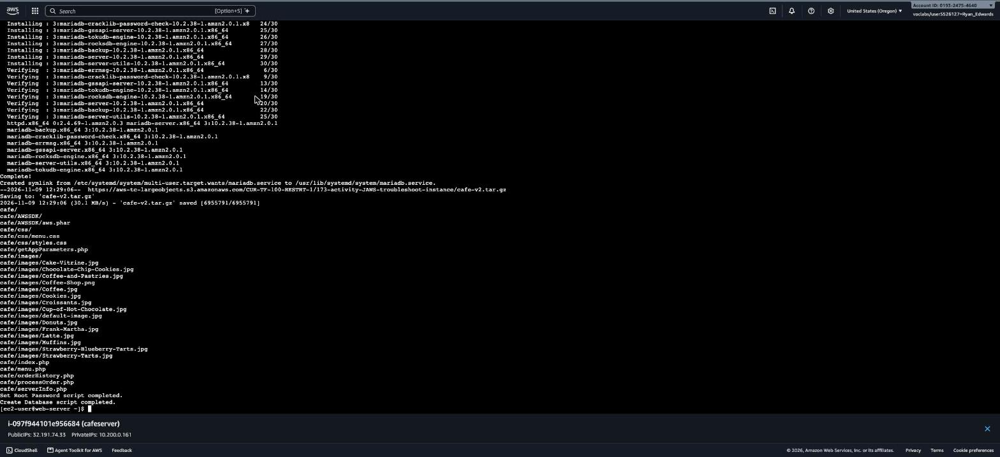
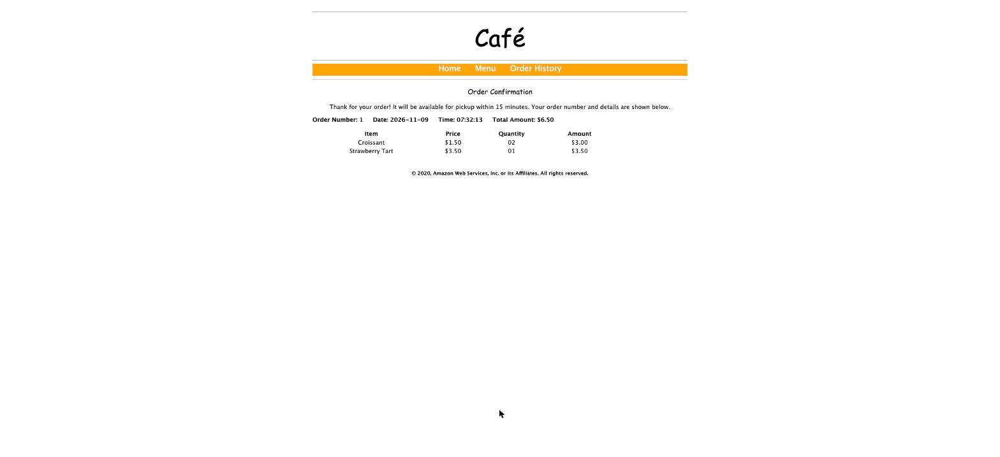
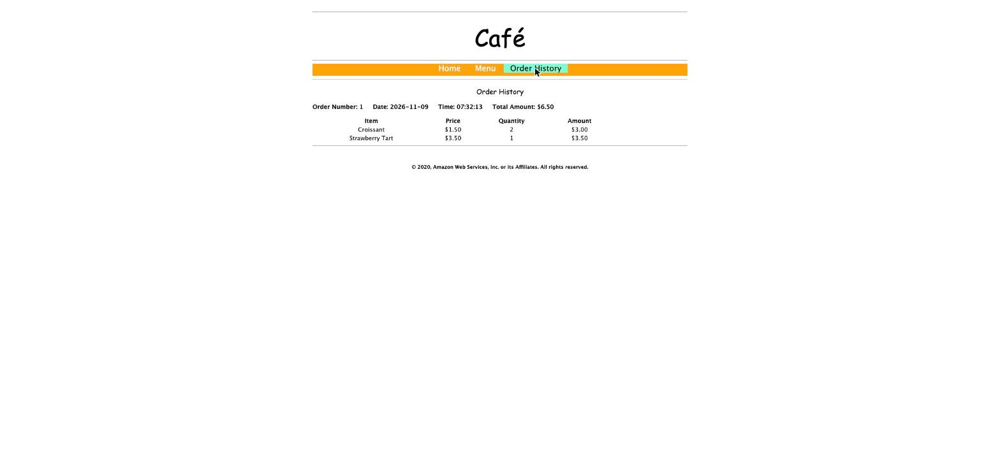

# AWS Hands-On Lab: Troubleshooting the Creation of an EC2 Instance

**Platform:** AWS Skill Builder (Vocareum)
**Date completed:** November 9, 2026
**Duration:** ~45 minutes
**Region:** US West (Oregon) — us-west-2

## Overview

This lab uses the AWS CLI to launch an EC2 instance that hosts a LAMP (Linux, Apache, MariaDB, PHP) stack running a fictional "Café" web application. The twist: the CLI launch script provided by the lab contains two intentional bugs, and the real work is finding and fixing them with nothing but the error messages, the script itself, and `nmap`.

**Scenario:** A pre-built `create-lamp-instance-v2.sh` script is supposed to look up an existing "Cafe VPC," create a new security group, and launch a `t3.small` EC2 instance running a user-data script that installs Apache, MariaDB, and PHP, then deploys the Café ordering app. Running it as-is fails.

## Objectives

- Launch an EC2 instance by using the AWS CLI.
- Troubleshoot AWS CLI commands and Amazon EC2 service settings by using basic troubleshooting tips and the open-source `nmap` utility.

## Architecture

```
AWS Cloud (us-west-2)
└── Cafe VPC
    └── Cafe Public Subnet 1
        ├── CLI Host (t3.micro) — EC2 Instance Connect entry point, AWS CLI configured here
        └── cafeserver (t3.small) — cafeSG security group (22, 80)
            └── Linux
                └── Apache HTTP Server
                    └── Café web application (PHP)
                        └── cafe_db (MariaDB)

Client --- http://<public-ip>/cafe ---> cafeserver
```

## Task 1: Connecting to the CLI Host instance

Connected to the `CLI Host` EC2 instance through **EC2 Instance Connect** (browser-based terminal) from the EC2 console — no SSH key needed.

**Result:** Session opened at `/home/ec2-user` on the CLI Host.

## Task 2: Configuring the AWS CLI

Ran `aws configure` and supplied the lab's temporary access key, secret key, region (`us-west-2`), and output format (`json`) from the lab's Cloud Access panel. Amazon Linux 2 ships with the AWS CLI preinstalled.

```
$ aws sts get-caller-identity
{
    "Account": "019324754640",
    "UserId": "AIDAQI76YLLICHVDFDFBCN",
    "Arn": "arn:aws:iam::019324754640:user/awsstudent"
}
```

**Result:** CLI configured and verified.

## Task 3: Creating an EC2 instance by using the AWS CLI

### Task 3.1 — Observing the script

Backed up the script before editing (`cp create-lamp-instance-v2.sh create-lamp-instance.backup`), then reviewed `create-lamp-instance-v2.sh` with line numbers. The script:

- Loops through every AWS region running `describe-vpcs` until it finds a VPC named `Cafe VPC`, capturing that region.
- Looks up the subnet, an existing key pair, and the latest Amazon Linux 2 AMI ID — all scoped correctly to the discovered `$region`.
- Checks for (and offers to delete) any leftover `cafeserver` instance or `cafeSG` security group from a previous run.
- Creates a new `cafeSG` security group and opens ports in it.
- Runs `aws ec2 run-instances` to launch the instance, then polls `describe-instances` until a public IP shows up.

### Task 3.2 — Running the script (expected failure)

Running `./create-lamp-instance-v2.sh` as provided fails, as the lab predicts.

### Task 3.3 — Troubleshooting

**Issue #1 — `InvalidAMIID.NotFound`.** Reading the script line by line turned up the bug before even running it: the AMI ID is looked up correctly in the discovered region —

```bash
imageId=$(aws ssm get-parameters \
  --names '/aws/service/ami-amazon-linux-latest/amzn2-ami-hvm-x86_64-gp2' \
  --profile $profile --region $region | grep ami- | cut -d '"' -f4 | sed -n 2p)
```

— but the `run-instances` call later hardcodes a different region instead of reusing `$region`:

```bash
instanceDetails=$(aws ec2 run-instances \
  --image-id $imageId \
  --count 1 \
  --instance-type $instanceType \
  --region us-east-1 \        # <-- bug: should be $region (us-west-2)
  --subnet-id $subnetId \
  ...
```

An AMI ID is region-specific, so an AMI resolved in `us-west-2` doesn't exist in `us-east-1` — exactly the `InvalidAMIID.NotFound` error the lab describes. Fixed it with:

```bash
sed -i '160s/us-east-1/$region/' create-lamp-instance-v2.sh
```

Re-ran the script. This time it also had to fight through a Service Control Policy that explicitly denies `ec2:DescribeVpcs` in every region except the lab's — the script's region-discovery loop just churns through those denials until it lands on `us-west-2`, which is expected lab-account behavior, not a bug. The instance then launched cleanly:

```
instanceId=i-097f944101e956684
Waiting for a public IP for the new instance...
The public IP of your LAMP instance is: 32.191.74.33
```



**Result:** `run-instances` succeeds; `cafeserver` is up with a public IP.

**Trying the webpage** at `http://32.191.74.33` failed, exactly as the lab describes — on to Issue #2.

**Issue #2 — webpage unreachable.** Installed `nmap` on the CLI Host and scanned the new instance:

```
$ sudo yum install -y nmap
$ nmap -Pn 32.191.74.33
PORT     STATE  SERVICE
22/tcp   open   ssh
8080/tcp closed http-proxy
```

Port 80 isn't even listed — the security group never opened it. Looking back at the script's security-group section confirmed the bug: the `echo` describing the step says "Opening port 80," but the actual `authorize-security-group-ingress` call underneath uses `--port 8080`:

```bash
echo "Opening port 80 in the new security group"
aws ec2 authorize-security-group-ingress \
  --group-id $securityGroup \
  --protocol tcp \
  --port 8080 \        # <-- bug: should be 80
  --cidr 0.0.0.0/0 \
  --region $region \
  --profile $profile
```

Fixed the rule on the live security group and in the script itself, then re-scanned:

```bash
aws ec2 authorize-security-group-ingress \
  --group-id sg-09adec4de6a39fc01 --protocol tcp --port 80 --cidr 0.0.0.0/0 --region us-west-2
sed -i '149s/8080/80/' create-lamp-instance-v2.sh
```

```
$ nmap -Pn 32.191.74.33
PORT     STATE  SERVICE
22/tcp   open   ssh
80/tcp   open   http
8080/tcp closed http-proxy
```




**Result:** Port 80 open; Apache reachable from the internet.

Verified the fix at the application layer too: `http://32.191.74.33` returned "Hello From Your Web Server!" and `sudo cat /var/log/cloud-init-output.log` on `cafeserver` confirmed the user-data script ran cleanly — Apache, MariaDB, and PHP installed; the Café app files extracted; `Set Root Password script completed.` and `Create Database script completed.` with no errors.




## Task 4: Verifying the functionality of the website

Loaded `http://32.191.74.33/cafe` — the Café home page rendered correctly (hero images, menu teasers, About Us, Contact Us).


Tested the ordering flow end to end: opened **Menu**, ordered 2 Croissants and 1 Strawberry Tart, and submitted. The Order Confirmation page showed Order #1 for $6.50 with correct line-item pricing — proof the PHP app is writing to the MariaDB database on the instance. Checking **Order History** afterward showed that same order read back from the database.




**Result:** Full LAMP stack confirmed working end to end — web tier, app tier, and database tier.

## Summary

Both bugs in `create-lamp-instance-v2.sh` turned out to be classic copy/paste and mismatch errors rather than anything exotic:

1. A hardcoded `--region us-east-1` in the `run-instances` call that should have used the dynamically discovered `$region` variable, causing an `InvalidAMIID.NotFound` error because AMI IDs don't travel across regions.
2. A security group rule whose `echo` said "port 80" but whose `--port` flag actually said `8080`, silently leaving the real web port closed and the site unreachable — caught with `nmap` rather than guesswork.

Along the way, the lab account's Service Control Policy denies `ec2:DescribeVpcs` everywhere except the lab's home region, which makes the script's region-discovery loop spray errors before it lands correctly — worth knowing isn't a bug, just how the lab sandbox is locked down.

Ended the lab afterward to tear down resources.
