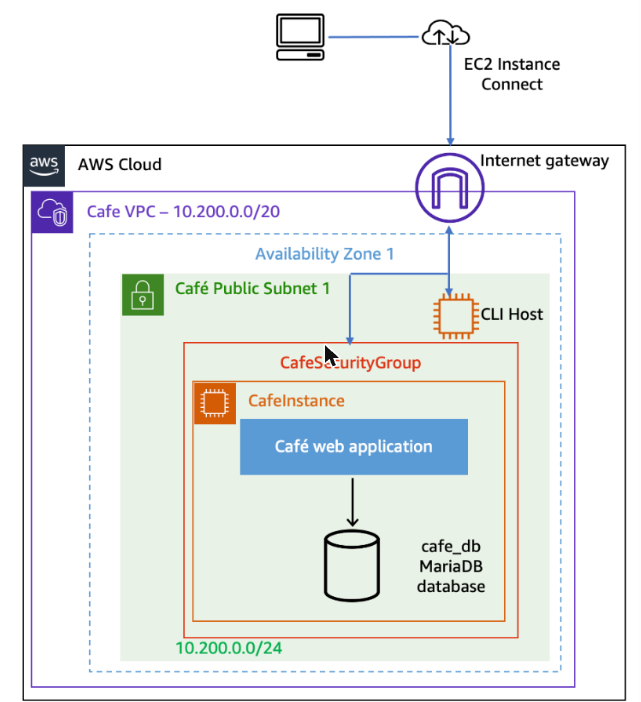
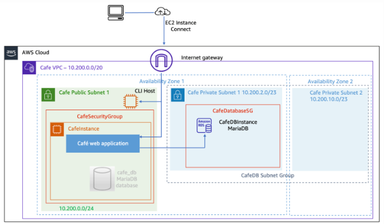
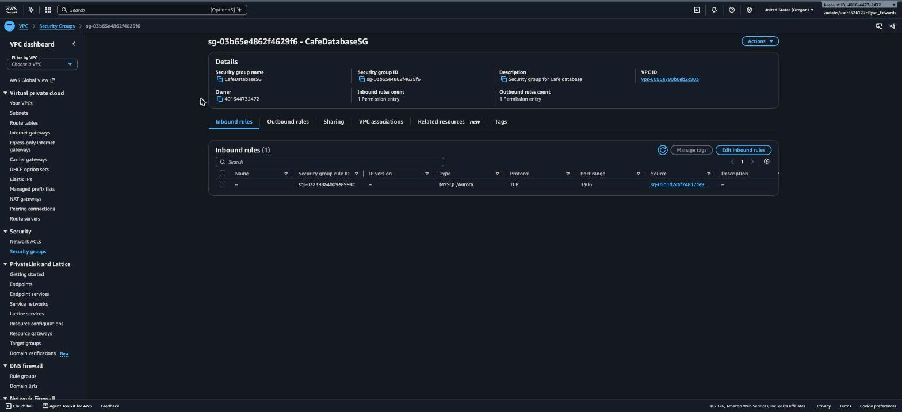
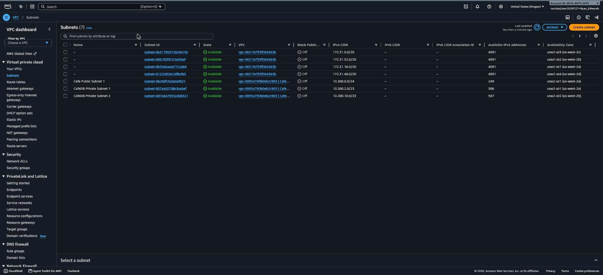
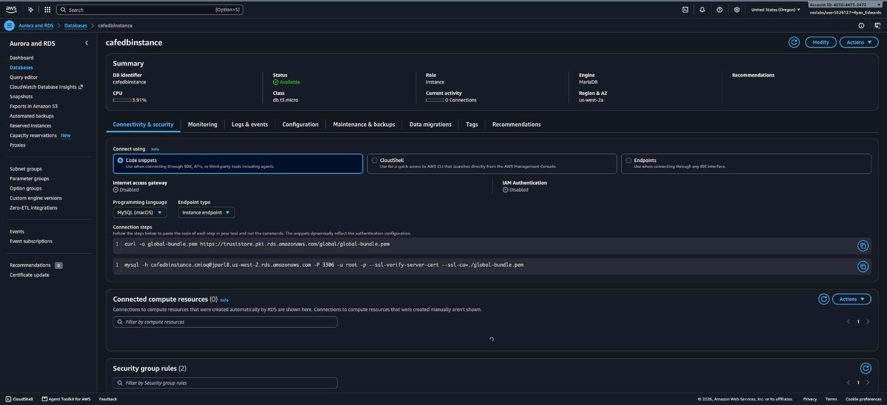
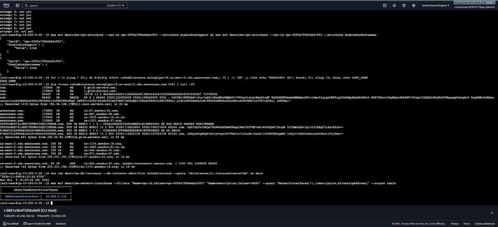
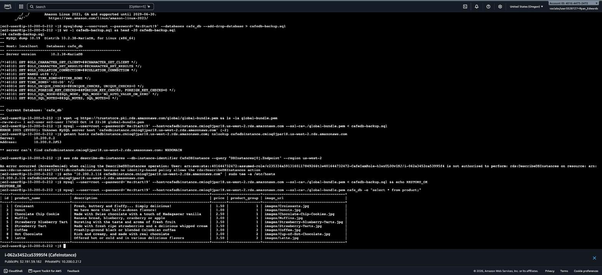
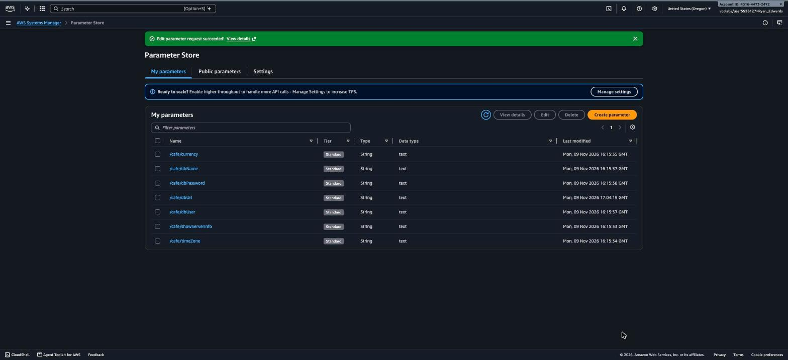
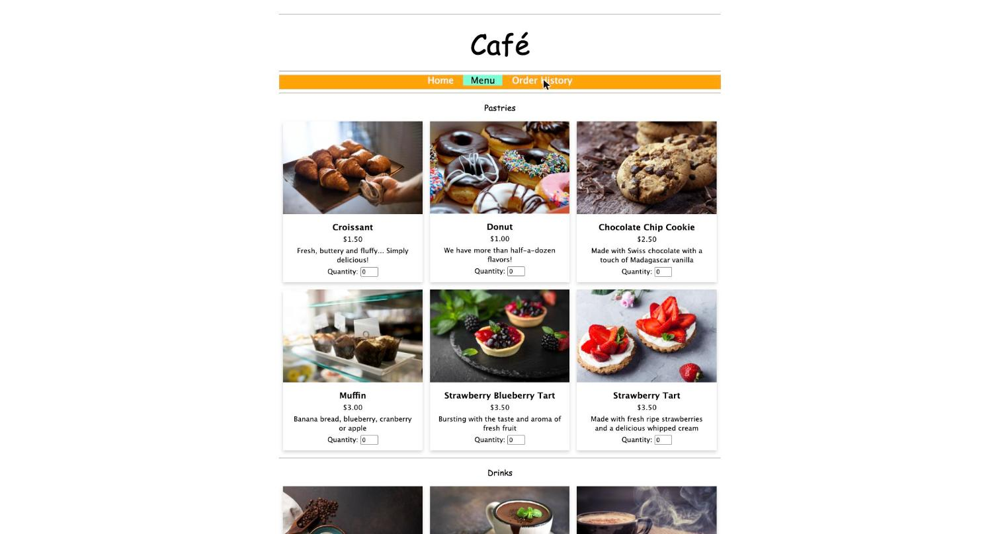
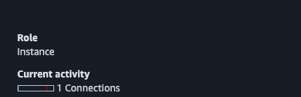

# AWS Hands-On Lab: Migrating to Amazon RDS

**Platform:** AWS Skill Builder (Vocareum)
**Date completed:** November 9, 2026
**Duration:** ~90 minutes
**Region:** US West (Oregon) — us-west-2

## Overview

This lab moves a running application's database off a self-managed MariaDB instance and onto a fully managed Amazon RDS instance, with zero downtime-causing code changes to the app itself. The starting point is a two-instance "Café" environment: a `CLI Host` used for administration and a `CafeInstance` running a LAMP stack (Apache + PHP + local MariaDB) that serves a café ordering site. The end state replaces the local MariaDB database with an Amazon RDS for MariaDB instance, with the application repointed to it purely through a Systems Manager Parameter Store value — no application code touched.

**Scope note:** The lab's Task 1 normally has the grader place a sample order through the café site to generate order history. Per instruction for this run, the café site's **Submit Order** button was never clicked — the site was browsed only (home page, menu, product listings). As a result, the data migrated to RDS is the full product/menu catalog and schema; no order rows exist because none were ever submitted. Every other task — security group, subnets, RDS provisioning, data migration, app cutover, and monitoring — was completed in full.

## Objectives

- Create a security group scoped to the new RDS instance
- Create new private subnets and a DB subnet group for RDS
- Create an Amazon RDS for MariaDB database instance
- Migrate the café application's data from local MariaDB to RDS
- Update the application to use the new RDS endpoint via Parameter Store
- Monitor the RDS instance with Amazon CloudWatch

## Architecture

**Starting architecture** (as provided by the lab):



**Final architecture** (migration target):



**What was actually built this run:**

```
Cafe VPC (10.200.0.0/20)
│
├─ Cafe Public Subnet 1 (10.200.0.0/24, us-west-2a)
│    ├─ CLI Host        (i-0881a3b4f7d3be649, 10.200.0.39)   — admin / CLI access
│    └─ CafeInstance     (i-062a3452ca53995f4, 10.200.0.212)  — Apache + PHP café app
│
├─ CafeDB Private Subnet 1 (10.200.2.0/23, us-west-2a)   ┐
├─ CafeDB Private Subnet 2 (10.200.10.0/23, us-west-2b)  ┘  "cafedb subnet group"
│         └─ Amazon RDS for MariaDB — cafedbinstance (10.11.19), 10.200.2.116
│
└─ Security groups:
     CafeSecurityGroup (sg-05d1d2caf74817ce9) — attached to CafeInstance/CLI Host
     CafeDatabaseSG     (sg-03b65e4862f4629f6) — attached to RDS; inbound 3306 from CafeSecurityGroup only

App cutover: SSM Parameter /cafe/dbUrl
  old: ec2-32-191-59-182.us-west-2.compute.amazonaws.com (local MariaDB on CafeInstance)
  new: cafedbinstance.cmioq0jpar18.us-west-2.rds.amazonaws.com (RDS)
```

## Task 1: Create a Security Group for the RDS Instance

1. In the Cafe VPC (`vpc-0095a790b0eb2c903`), created a new security group:
   - **Name:** `CafeDatabaseSG`
   - **Description:** Security group for Cafe database
2. Added one inbound rule: **MySQL/Aurora, TCP 3306**, source = `CafeSecurityGroup` (`sg-05d1d2caf74817ce9`) — the security group already attached to `CafeInstance` and `CLI Host`. No other source is permitted to reach the database on 3306.



**Result:** `CafeDatabaseSG` (`sg-03b65e4862f4629f6`) created with database access locked to the application's own security group — no broader CIDR or public access.

## Task 2: Create Private Subnets and a DB Subnet Group

1. Created two new private subnets inside the Cafe VPC, each in a different Availability Zone (RDS requires at least two AZs for a subnet group):
   - `CafeDB Private Subnet 1` — `10.200.2.0/23` — us-west-2a (`subnet-007ea50708c9ac6ef`)
   - `CafeDB Private Subnet 2` — `10.200.10.0/23` — us-west-2b (`subnet-0d7a647935c408321`)
2. Created a DB subnet group named `cafedb subnet group` ("DB subnet group for Cafe") spanning both new subnets.



**Result:** DB subnet group reached **Complete** status, ready to host the RDS instance across two AZs with no public subnet involved.

## Task 3: Create the Amazon RDS Database Instance

1. RDS → Create database → Standard create → **Engine: MariaDB**.
2. The lab's specified engine version (10.11.11) was no longer offered — `create-db-instance` failed with `InvalidParameterCombination: Cannot find version 10.11.11 for mariadb`. Queried the currently supported 10.11.x releases:
   ```bash
   aws rds describe-db-engine-versions --engine mariadb \
     --query "DBEngineVersions[?starts_with(EngineVersion, '10.11')].EngineVersion" --output text
   # 10.11.13  10.11.14  10.11.15  10.11.16  10.11.18  10.11.19
   ```
   Retried with **10.11.19** (newest available in the 10.11 line) and creation succeeded.
3. Configuration: **DB instance identifier** `CafeDBInstance`, class `db.t3.micro`, standard storage, **master username** `root` / password `Re:Start!9` (self-managed, matching the lab's existing local-DB credentials so the app's connection logic needed no changes), **VPC** Cafe VPC, **subnet group** `cafedb subnet group`, **Public access** No, **VPC security group** `CafeDatabaseSG` only (default SG removed).



**Result:** Instance reached **Available** status in AZ us-west-2a, with endpoint `cafedbinstance.cmioq0jpar18.us-west-2.rds.amazonaws.com:3306`.

## Task 4: Migrate the Café Database to RDS

1. On `CafeInstance`, dumped the local database:
   ```bash
   mysqldump --user=root --password='Re:Start!9' --databases cafe_db --add-drop-database > cafedb-backup.sql
   # 144 lines — full cafe_db schema plus the 9-row product catalog (no order rows, per the scope note above)
   ```
2. Downloaded the RDS CA bundle for TLS verification:
   ```bash
   wget -q https://truststore.pki.rds.amazonaws.com/global/global-bundle.pem
   ```
3. **First restore attempt failed:** connecting to the RDS endpoint by hostname returned `ERROR 2005 (HY000): Unknown MySQL server host 'cafedbinstance.cmioq0jpar18.us-west-2.rds.amazonaws.com' (-2)`. This turned into real troubleshooting rather than a quick retry:
   - Ruled out a typo — confirmed the endpoint string byte-for-byte via `aws rds describe-db-instances` from the CLI Host.
   - Ruled out VPC-resolver-specific failure — the public resolver (`@8.8.8.8`) also failed to resolve the name.
   - Ruled out VPC DNS misconfiguration — both `EnableDnsSupport` and `EnableDnsHostnames` were confirmed `true` on the VPC.
   - Ruled out ordinary propagation delay — polled with `dig +short` for 20 attempts over several minutes with no result.
   - Ran `dig +trace` against the hostname: the delegation chain resolved correctly all the way to the authoritative `us-west-2.rds.amazonaws.com` nameservers, which returned only an SOA/NODATA response — confirming the DNS record genuinely did not exist yet at the authoritative level, 25+ minutes after the instance's `InstanceCreateTime`.

   

4. Found the instance's actual private IP directly via the network interface attached to it:
   ```bash
   aws ec2 describe-network-interfaces --filters "Name=vpc-id,Values=vpc-0095a790b0eb2c903" "Name=description,Values=*RDS*" \
     --query "NetworkInterfaces[*].[Description,PrivateIpAddress]" --output table
   # RDSNetworkInterface  10.200.2.116
   ```
5. A quick fix would have been to connect straight to that IP with certificate hostname verification disabled (`--ssl-verify-server-cert=0`) — this was deliberately rejected since it weakens TLS validation. Instead, added a static DNS override that keeps full certificate verification intact:
   ```bash
   echo "10.200.2.116 cafedbinstance.cmioq0jpar18.us-west-2.rds.amazonaws.com" | sudo tee -a /etc/hosts
   ```
   Then re-ran the **original, unmodified** restore command — now resolvable via the hosts override, with `--ssl-ca` verification still fully enforced:
   ```bash
   mysql --user=root --password='Re:Start!9' --host=cafedbinstance.cmioq0jpar18.us-west-2.rds.amazonaws.com \
     --ssl-ca=./global-bundle.pem < cafedb-backup.sql && echo RESTORE_OK
   ```
6. Verified the restore directly against RDS:
   ```sql
   SELECT * FROM product;
   ```



**Result:** `cafe_db` schema and the complete 9-item product catalog (Croissant, Donut, Chocolate Chip Cookie, Muffin, Strawberry Blueberry Tart, Strawberry Tart, Coffee, Hot Chocolate, Latte) migrated to RDS and verified row-for-row against the source dump, with TLS certificate validation never weakened.

## Task 5: Point the Café Application at RDS

1. Opened Systems Manager → Parameter Store → `/cafe/dbUrl` → **Edit**.
2. Replaced the value:
   - Old: `ec2-32-191-59-182.us-west-2.compute.amazonaws.com` (CafeInstance's local database)
   - New: `cafedbinstance.cmioq0jpar18.us-west-2.rds.amazonaws.com` (the RDS endpoint)
3. Saved changes.



4. Reloaded the café site (`http://32.191.59.182/cafe`) and its Menu page — all 9 products rendered with correct names, descriptions, and prices, with no database-connection errors.



As noted under Scope, the **Submit Order** button was deliberately never clicked — verification was limited to browsing (home page and menu) to confirm read access through the new database, without generating an order.

**Result:** The application now serves 100% of its data from Amazon RDS with a single Parameter Store edit — no code or redeploy required.

## Task 6: Monitor the RDS Instance

1. Opened `cafedbinstance` → **Monitoring** tab and reviewed the CloudWatch metric set (CPUUtilization, DatabaseConnections, BurstBalance, CPU credit metrics, disk/IOPS checks).
2. From `CafeInstance`, opened a fresh **interactive** `mysql` session straight to the RDS endpoint (not a one-shot `-e` query) to generate a live connection:
   ```bash
   mysql --user=root --password='Re:Start!9' --host=cafedbinstance.cmioq0jpar18.us-west-2.rds.amazonaws.com \
     --ssl-ca=./global-bundle.pem cafe_db
   ```
   Ran `SELECT COUNT(*) FROM product;` (returned 9) and kept the session open.
3. Refreshed the RDS instance summary — **Current activity** flipped from **0 Connections** to **1 Connections** in real time, confirming the session.



The instance uses Standard (not Enhanced) monitoring, so the `DatabaseConnections` CloudWatch graph itself is on a 5-minute collection interval and had not yet plotted the new data point in the time available — the live **Current activity** counter was the practical way to confirm the connection in real time. The session was then closed cleanly with `exit`.

**Result:** Live database connectivity confirmed through the RDS console's monitoring surface, with CloudWatch metrics (CPU, credits, connections) all visible and populated for the instance.

## Verification Summary

| Step | Expected Result | Observed |
|---|---|---|
| CafeDatabaseSG created | Inbound 3306 from CafeSecurityGroup only | ✅ Confirmed via SG detail page |
| CafeDB subnet group | Status = Complete, 2 AZs | ✅ `cafedb subnet group` Complete |
| RDS instance created | Status = Available | ✅ `cafedbinstance` Available, MariaDB 10.11.19 |
| Data migration | Row-for-row match with source dump | ✅ All 9 product rows verified on RDS |
| TLS integrity during fix | Certificate verification never disabled | ✅ `/etc/hosts` override used instead of `--ssl-verify-server-cert=0` |
| Parameter Store cutover | `/cafe/dbUrl` → RDS endpoint | ✅ Edit succeeded, confirmed in console |
| App serving from RDS | Menu page loads with no DB errors | ✅ All 9 products rendered correctly |
| Live monitoring | Connection visible in console | ✅ Current activity: 0 → 1 Connections |

## Key Takeaways

- **An RDS instance reporting "Available" doesn't guarantee its DNS record is live.** `describe-db-instances` showed `available` well before the hostname resolved anywhere — including at the authoritative Route 53 nameservers, confirmed with `dig +trace`. Don't assume a hostname failure this early is a config mistake; it can be a genuine, if unusual, propagation gap.
- **A DNS workaround doesn't have to cost you TLS security.** The fast fix (`--ssl-verify-server-cert=0` against the raw IP) was rejected because it disables certificate hostname verification. A static `/etc/hosts` entry achieved the same connectivity while leaving the original, unmodified command — full `--ssl-ca` verification included — completely intact.
- **Lab-specified engine versions go stale.** The README's MariaDB 10.11.11 had aged out of availability; querying `describe-db-engine-versions` for the current 10.11.x line kept every other step unchanged.
- **Parameter Store makes a database migration a one-line cutover.** Because the café app reads its connection string from `/cafe/dbUrl` instead of a hardcoded value, moving from local MariaDB to RDS required editing exactly one parameter — no code change, no redeploy.
- **Security stayed layered the whole way through.** `CafeDatabaseSG` only trusts the application's own security group on port 3306, the RDS instance has no public access, and even under DNS pressure the fix path never weakened certificate validation.
