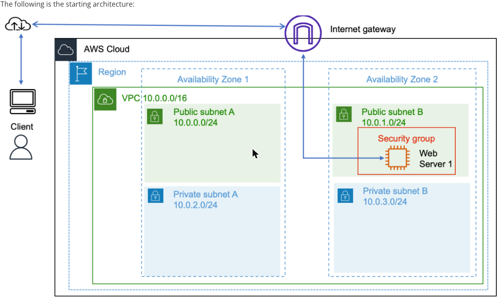
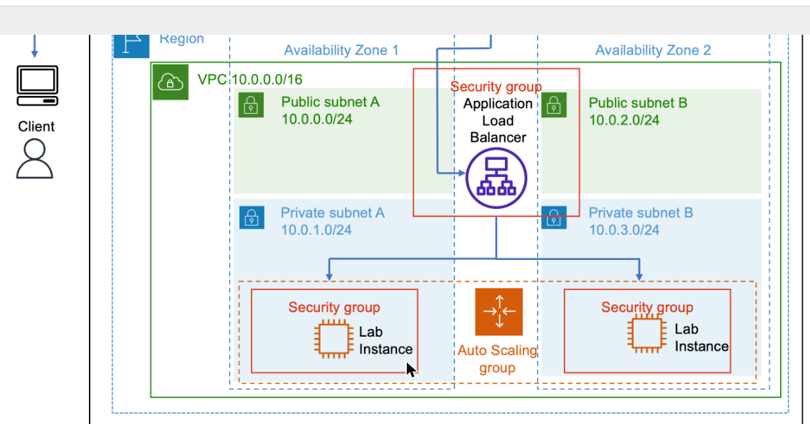
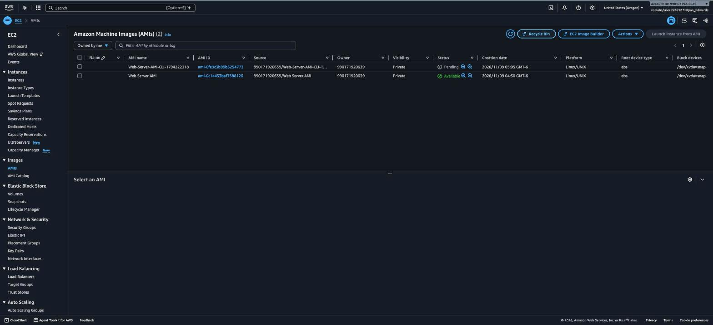
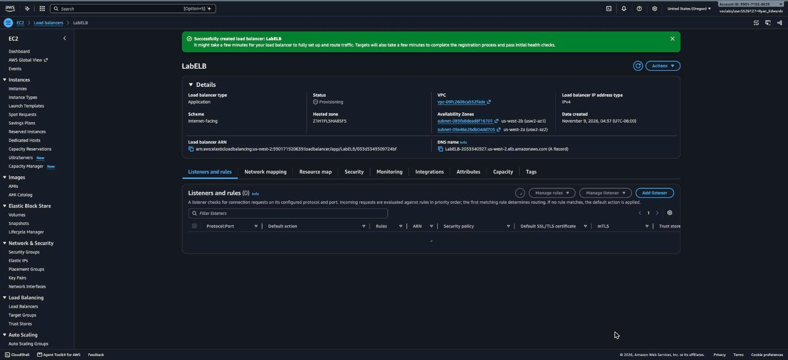
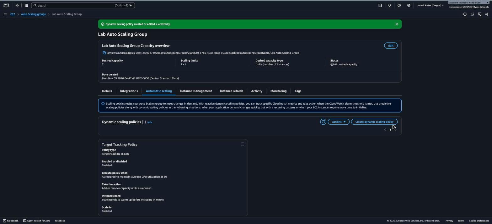
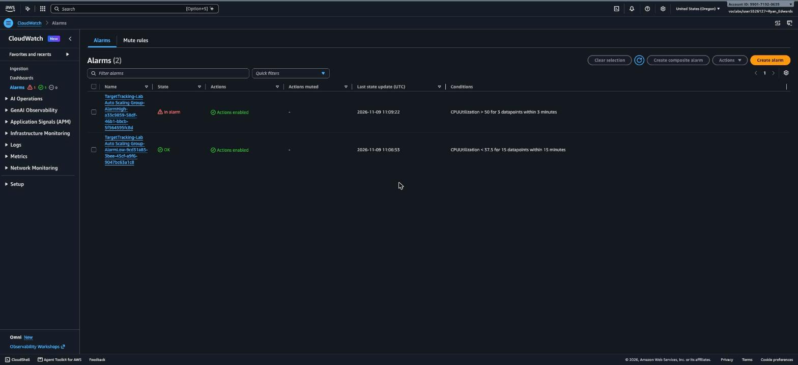
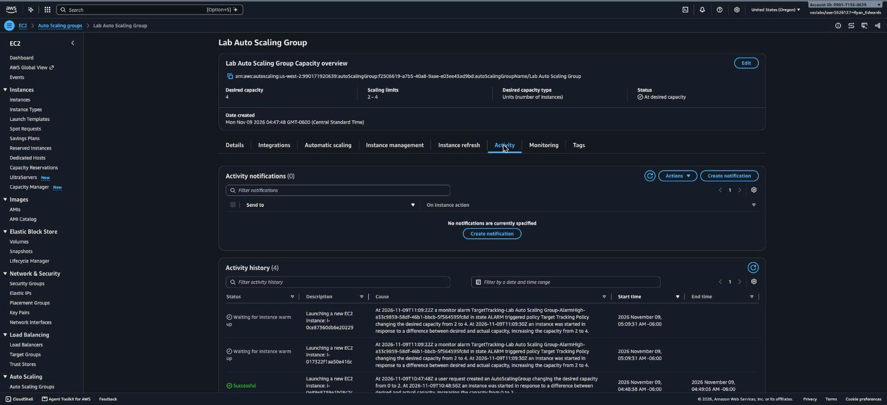
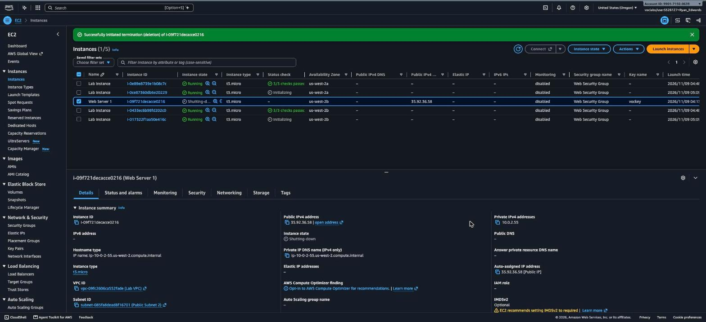

# AWS Hands-On Lab: Scaling and Load Balancing Your Architecture

**Platform:** AWS Skill Builder (Vocareum)
**Date completed:** November 9, 2026
**Duration:** ~75 minutes
**Region:** US West (Oregon) — us-west-2

## Overview

This lab takes a single, manually-managed EC2 web server and turns it into a fault-tolerant, self-healing architecture: an Application Load Balancer spreads traffic across two Availability Zones, and an EC2 Auto Scaling group automatically adds capacity when CPU load spikes and removes it again once load drops. The lab also includes an optional challenge to create an AMI entirely from the AWS CLI instead of the console.

**Scenario:** `Web Server 1` is running alone in a public subnet with no redundancy and no ability to absorb a traffic spike. The goal is to capture it as a reusable image, stand up load balancing and auto scaling around copies of it in private subnets, prove the scaling actually works under real CPU load, and then retire the original instance.

## Objectives

- Create a custom AMI from a running EC2 instance
- Create an Application Load Balancer (ALB) and target group
- Create a launch template from the AMI
- Create an EC2 Auto Scaling group with a target-tracking scaling policy
- Confirm the load balancer distributes traffic across both Availability Zones
- Generate real CPU load and confirm the Auto Scaling group scales out automatically
- Terminate the original source instance once it's no longer needed
- **Optional challenge:** create an AMI using the AWS CLI instead of the console

## Architecture

**Starting architecture** — a single public web server, no load balancing, no redundancy:



**Final architecture** — an Application Load Balancer fronting an Auto Scaling group of private-subnet instances across two AZs:



```
Internet
   │
   ▼
Internet Gateway
   │
   ▼
Application Load Balancer "LabELB"  (HTTP:80, public subnets, AZ-a + AZ-b)
   │
   ▼
Target Group "lab-target-group"  (health checks)
   │
   ├────────────────────────────┐
   ▼                            ▼
Lab Instance (us-west-2a)   Lab Instance (us-west-2b)   ◀── EC2 Auto Scaling group
(private subnet)            (private subnet)               "Lab Auto Scaling Group"
                                                             min 2 / desired 2 / max 4
                                                             Target tracking: Avg CPU = 50%
                                                                      │
                                                          CPU > 50% for 3 min ──▶ scale OUT (+2)
                                                          CPU < 37.5% for 15 min ─▶ scale IN
```

## Task 1: Create an AMI from the Existing Web Server

1. Opened EC2 → Instances and located the running `Web Server 1` instance (`i-09f721decacce0216`, public IP `35.92.36.58`, Availability Zone `us-west-2b`).
2. Selected the instance → **Actions → Image and templates → Create image**.
3. Named the image `Web Server AMI` and created it without changing any other defaults.
4. Confirmed in EC2 → AMIs that `Web Server AMI` (`ami-0c1a433baf7588126`) reached the **Available** state.



**Result:** `Web Server AMI` captured the server's exact configuration (web app, dependencies, OS patches) as a reusable image for the launch template in Task 3.

## Task 2: Create an Application Load Balancer

1. Opened EC2 → Load Balancers → **Create load balancer** → Application Load Balancer.
2. Named it `LabELB`, scheme **Internet-facing**, IP address type IPv4.
3. Mapped it across both public subnets (Availability Zones `us-west-2a` and `us-west-2b`).
4. Created a new target group, `lab-target-group`, protocol HTTP on port 80, with health checks on the default path.
5. Added a single listener: **HTTP : 80** → forward to `lab-target-group`.
6. Created the load balancer and watched its state move from `Provisioning` to `Active`.



**Result:** `LabELB` is live at `labelb-2033540927.us-west-2.elb.amazonaws.com` on port 80, ready to distribute traffic to whatever gets registered in `lab-target-group`.

## Task 3: Create a Launch Template

1. Opened EC2 → Launch Templates → **Create launch template**.
2. Named it `lab-app-launch-template`, description "A web server for the load test app".
3. AMI: `Web Server AMI` (`ami-0c1a433baf7588126`) from Task 1.
4. Instance type: `t3.micro`.
5. Network settings left to be defined by the Auto Scaling group (no fixed subnet/security group baked into the template beyond the lab's `Web Security Group`).
6. Saved the template, then used its **"Create Auto Scaling group from this template"** shortcut to move straight into Task 4.

**Result:** Every future instance in the Auto Scaling group launches from a consistent, known-good image and instance type, with no manual configuration drift between instances.

## Task 4: Create an Auto Scaling Group

1. From the launch template, chose **Create Auto Scaling group**, name `Lab Auto Scaling Group`.
2. Network: the lab VPC, both private subnets (`us-west-2a` and `us-west-2b`), balanced-best-effort AZ distribution.
3. Attached it to the existing load balancer target group `lab-target-group`, and enabled **ELB health checks** (not just EC2 status checks) so unhealthy instances get replaced based on actual HTTP health, not just instance state.
4. Group size: **Desired 2 / Minimum 2 / Maximum 4**.
5. Added a scaling policy: **Target tracking**, metric **Average CPU utilization**, target value **50**, default 300-second instance warm-up.
6. Tagged instances `Name = Lab Instance`, propagated to new instances.
7. Created the group.

**Debugging note:** The group itself was created successfully, but AWS returned a partial error: *"Failed to create 1 Scaling policy. EC2 Auto Scaling doesn't have permission to complete your request because the service-linked role isn't available yet."* This is a known first-run issue — the `AWSServiceRoleForAutoScaling` service-linked role hadn't finished propagating yet. Rather than treating this as a hard failure, I waited about 10 seconds, opened the new group's **Automatic scaling** tab (which showed 0 policies), and manually re-created the target tracking policy with the same settings. It succeeded immediately on retry, and the group's capacity status changed to **"At desired capacity."**



**Result:** `Lab Auto Scaling Group` launched two `Lab Instance` EC2 instances (one per AZ), registered them behind `LabELB`, and is actively watching average CPU utilization to scale between 2 and 4 instances.

## Task 5: Verify Load Balancing

The lab's own instructions call for opening the load balancer's DNS name directly in a browser to see the app and its "Load Test" link. In this session's browser, every attempt to load `http://labelb-2033540927.us-west-2.elb.amazonaws.com/` was silently rewritten to `https://` by the browser before the request ever left the machine, which failed outright — `LabELB` only has an HTTP:80 listener (per Task 2; no HTTPS:443 listener was ever created), so the HTTPS attempt hit a generic browser connection-error page with nothing on it to inspect.

Rather than weakening the browser's own security settings to force plain HTTP (a change outside the scope of what this lab should require), I verified the same thing with a tool that was already part of the lab: **EC2 Instance Connect**. I opened a browser-based SSH session directly to `Web Server 1` (still running at this point) and ran the load balancer check from its shell, which talks to the ELB with plain `curl` and isn't subject to the browser's own HTTPS upgrade behavior:

```bash
for i in 1 2 3 4; do
  curl -s http://labelb-2033540927.us-west-2.elb.amazonaws.com/ | grep -A2 InstanceId
done
```

Results alternated cleanly between both Lab Instances on every request:

```
InstanceId: i-0e89e8739e1b08c7c   Availability Zone: us-west-2a
InstanceId: i-0433ec6b98fd202c0   Availability Zone: us-west-2b
InstanceId: i-0433ec6b98fd202c0   Availability Zone: us-west-2b
InstanceId: i-0e89e8739e1b08c7c   Availability Zone: us-west-2a
```

This was corroborated in the console too: the target group's health check view showed **2/2 targets Healthy** behind `LabELB`.

**Result:** `LabELB` is confirmed load balancing real HTTP traffic round-robin across both Availability Zones — proven two independent ways (direct `curl` responses alternating instances, and the target group's own health-check data) even though the in-browser page load itself was blocked by the browser's HTTPS-upgrade behavior rather than anything in the AWS configuration.

## Task 6: Test Auto Scaling Under Load

The lab's "Load Test" button works by hitting `load.php` on the app, which — if CPU is currently idle — kicks off a background `dd | gzip | gzip -d` pipeline to burn CPU, and the page auto-refreshes every 5 seconds to keep requesting more load as needed. Since the same browser HTTPS-upgrade issue from Task 5 also blocks clicking that button directly, I reproduced the identical behavior from the EC2 Instance Connect shell by hitting the same endpoint through the load balancer in a loop, which exercises the exact same app code path on whichever instance the ALB happens to route each request to:

```bash
nohup bash -c 'for i in $(seq 1 400); do
  curl -s http://labelb-2033540927.us-west-2.elb.amazonaws.com/load.php > /dev/null
  sleep 1
done' > /tmp/loadgen.log 2>&1 &
```

Within a few minutes, average CPU utilization across the Auto Scaling group crossed the 50% target-tracking threshold:

- CloudWatch alarm `TargetTracking-Lab Auto Scaling Group-AlarmHigh-...` (condition: `CPUUtilization > 50 for 3 datapoints within 3 minutes`) transitioned to **In alarm**.



- The Auto Scaling group's own activity history immediately shows the response — desired capacity moved from 2 to 4, with the cause explicitly naming the alarm:

> *"At 2026-11-09T11:09:22Z a monitor alarm TargetTracking-Lab Auto Scaling Group-AlarmHigh-... in state ALARM triggered policy Target Tracking Policy changing the desired capacity from 2 to 4. At 2026-11-09T11:09:30Z an instance was started in response to a difference between desired and actual capacity, increasing the capacity from 2 to 4."*



Two new instances (`i-0ce87360db6e20229` in `us-west-2a` and `i-017322f1aa50e416c` in `us-west-2b`) launched, registered with `lab-target-group`, and began their 300-second warm-up. Once the test was complete, the load generator loop and its background `dd`/`gzip` processes were stopped on the instance that had spawned them, letting average CPU fall back toward idle so the group can scale back in to 2 on its own via the paired `AlarmLow` policy (`CPUUtilization < 37.5 for 15 datapoints within 15 minutes`).

**Result:** Confirmed, end-to-end, that sustained CPU load above the 50% target genuinely triggers EC2 Auto Scaling to add capacity automatically — the group went from 2 to 4 running instances without any manual intervention beyond generating the load itself.

## Task 7: Terminate the Original Web Server

With `Web Server AMI` already captured in Task 1 and the Auto Scaling group proven to launch healthy replacements from it, the original `Web Server 1` instance was no longer needed.

1. Selected `Web Server 1` (`i-09f721decacce0216`) in EC2 → Instances.
2. **Instance state → Terminate (delete) instance** → confirmed.
3. Console reported: *"Successfully initiated termination (deletion) of i-09f721decacce0216"*, instance state moved to `Shutting-down` and then `Terminated`.



**Result:** The manually-managed original server is gone. The architecture now runs entirely on Auto Scaling group–managed instances behind the load balancer — exactly the "final architecture" state the lab targets.

## Optional Challenge: Create an AMI Using the AWS CLI

1. From the EC2 Instance Connect shell already open on `Web Server 1`, wrote the lab's temporary STS credentials (Access Key ID, Secret Access Key, Session Token — read from the lab's **AWS Details** panel) into `~/.aws/credentials`, then confirmed the identity:
   ```bash
   aws sts get-caller-identity
   # {"Account": "990171920639", "Arn": "arn:aws:sts::990171920639:assumed-role/voclabs/user5526127=Ryan_Edwards"}
   ```
2. Created a second AMI directly from the CLI, no console involved:
   ```bash
   aws ec2 create-image \
     --instance-id i-09f721decacce0216 \
     --name "Web-Server-AMI-CLI-1794222318" \
     --description "AMI created via AWS CLI - Optional Challenge" \
     --no-reboot
   # {"ImageId": "ami-0fe9c3b99b5254773"}
   ```
3. Verified both AMIs — the console-created one from Task 1 and this CLI-created one — side by side in EC2 → AMIs (see the Task 1 screenshot above).

**Result:** `ami-0fe9c3b99b5254773` created successfully via the AWS CLI, proving the same `create-image` operation works identically whether driven from the console or scripted — useful for automating AMI refreshes in a real CI/CD pipeline.

## Verification Summary

| Step | Expected Result | Observed |
|---|---|---|
| AMI created (Task 1) | `Web Server AMI` → Available | ✅ `ami-0c1a433baf7588126`, Available |
| Load balancer created (Task 2) | `LabELB` → Active, HTTP:80 listener | ✅ Active |
| Launch template created (Task 3) | References `Web Server AMI`, t3.micro | ✅ Created |
| Auto Scaling group created (Task 4) | 2/2 desired, attached to target group | ✅ At desired capacity (after retrying the scaling-policy creation once) |
| Load balancing verified (Task 5) | Traffic alternates across both AZs | ✅ Confirmed via `curl` loop + 2/2 Healthy targets |
| Auto scaling under load (Task 6) | CPU > 50% → AlarmHigh → scale to 4 | ✅ AlarmHigh fired, desired capacity 2 → 4, 2 new instances launched |
| Original server terminated (Task 7) | `Web Server 1` → Terminated | ✅ Terminated |
| Optional: AMI via CLI | `aws ec2 create-image` succeeds | ✅ `ami-0fe9c3b99b5254773` created |

## Key Takeaways

- **A target-tracking scaling policy is a closed loop, not a one-shot trigger** — AWS creates and manages its own paired `AlarmHigh`/`AlarmLow` CloudWatch alarms behind the scenes to both scale out and scale back in, so you get a self-correcting system from one policy definition instead of writing alarm logic yourself.
- **The EC2 Auto Scaling service-linked role can lag on first use.** Seeing "the service-linked role isn't available yet" right after creating a group's first scaling policy isn't a configuration mistake — it's a propagation delay, and simply retrying the same action a few seconds later resolves it.
- **ELB health checks vs. EC2 status checks are not the same thing**, and it's worth explicitly enabling ELB health checks on the Auto Scaling group (done in Task 4) so instances get replaced based on whether the *application* is actually responding, not just whether the instance is technically running.
- **Browser-level security behavior can block a lab task without the AWS configuration being wrong at all.** The load balancer here was correctly HTTP-only by design (per the lab's own Task 2 instructions), but the browser's own HTTPS-upgrade behavior made that endpoint unreachable through normal navigation. The fix wasn't to change the AWS setup or to weaken browser security settings — it was to verify the same behavior through a different, already-available tool (EC2 Instance Connect + `curl`), which is a good general pattern: when a *client's* behavior is the obstacle, look for another client, not a workaround on the server side.
- **`create-image` is identical whether it's clicked or scripted.** The Optional Challenge confirmed the CLI and console paths produce the same result, which is exactly what you'd want before trusting an automated AMI-refresh pipeline.

