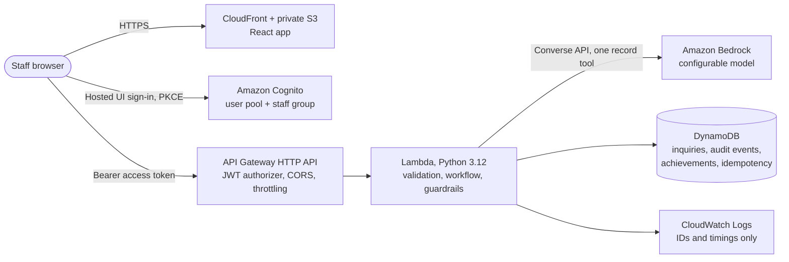

# LeadRescue: CloudQuest Business Solutions Lab

**Catch the lead. Rescue the opportunity.**

LeadRescue helps a moving company work one mixed queue of quote requests, schedule changes, and urgent customer problems. AI suggests the intent, priority, extracted details, and a reply draft. Staff review and correct it, complete a verification checklist, and approve the reply. Every change is audited. **Nothing is ever sent automatically, and no price, availability, or booking is ever confirmed by the system.**

Inboxic, an original lavender psychic fox, is the companion for this module. Its signature ability is *Priority Mind*. XP and achievements reward measurable review quality in a separate practice workspace and never touch business records.

> Independent portfolio project. Inboxic and all companions are original characters. Not affiliated with or endorsed by Nintendo, The Pokémon Company, or Amazon Web Services.

## Quick start (demo mode, no AWS needed)

Requirements: Node.js 20+ and Python 3.12+.

```bash
npm run setup
```

```bash
npm start
```

Open http://127.0.0.1:8787 and choose a demo staff profile. `npm start` builds the frontend and serves it with the local API on one port.

For hot reload during development, run `npm run dev` instead and open http://localhost:5173.

To clear local data and reseed the synthetic records:

```bash
npm run reset:demo
```

## What works in demo mode

- Staff sign-in with fictional profiles, 60-minute session expiry, sign-out, and an expired-session message.
- Mission control: counts (awaiting review, urgent open, approved drafts, challenge cases completed), search, and filters for category, priority, status, and assignee. Filters live in the URL, so they survive refresh.
- Inquiry workspace: original message, analysis summary, suggested category and priority with a reason, extracted details with **Not provided** markers, editable category/priority/assignee/draft, required human verification, separate save/approve/resolve actions, copy-approved-response, and timestamped audit history.
- Deterministic **simulated** analysis that uses the same response contract, schema validation, and guardrails as the Bedrock provider. It is labeled "Simulated analysis (demo rules)" everywhere. It is not AI.
- Monday Morning Rush practice challenge with five synthetic cases, criteria-based XP, duplicate-proof awards, and three achievements.
- Business results: counts by category and status, time to first review, time to resolution, and AI correction rates, each labeled Measured, Target, or Sample data.
- AWS build guide page with the architecture, deployment, configuration, cleanup, and limitations.
- Local JSON persistence that survives refresh and restart.

## What requires AWS configuration

| Capability | Requirement |
|---|---|
| Live AI analysis | `AI_PROVIDER=bedrock`, AWS credentials, and a `BEDROCK_MODEL_ID` your account can invoke with the Converse API and tool use |
| Cognito sign-in | Deployed stack plus frontend built with `VITE_AUTH_MODE=cognito` and the Cognito outputs |
| DynamoDB storage, CloudWatch logs, CloudFront hosting | `sam deploy` |

If Bedrock is selected but unavailable or misconfigured, the inquiry is still saved, staff see a clear error with a manual path and a retry button, and the system **never** silently falls back to simulated results.

You can also run the local server against live Bedrock while keeping local storage:

```bash
AI_PROVIDER=bedrock BEDROCK_MODEL_ID=us.anthropic.claude-haiku-4-5-20251001-v1:0 BEDROCK_REGION=us-east-1 python3 backend/local_server.py
```

The mode banner then reads "Live AI mode". **Live Bedrock analysis has not been tested against a real model in this build.** The provider is covered by unit tests with a stubbed client only.

## Architecture



Main workflow: customer inquiry is saved → AI analyzes it → staff review and correct → staff complete verification and approve the draft → status and audit history update → staff copy the reply into their own tools and resolve.

See [docs/ARCHITECTURE.md](docs/ARCHITECTURE.md) for design decisions, security controls, and the data model.

## Project layout

```
leadrescue/
  backend/
    src/leadrescue/        Lambda package (api, service, auth, validation, practice, metrics)
      analysis/            provider interface, Bedrock + demo providers, prompt, contract, guardrails
      store/               LocalStore (demo) and DynamoStore (AWS)
    local_server.py        local API Gateway emulator, demo auth, seeding, static hosting
    data/seed_inquiries.json   synthetic business records
    tests/                 pytest unit + integration tests (incl. DynamoDB via moto)
  frontend/                React + TypeScript + Vite app, Vitest unit tests, Playwright browser tests
  eval/                    52-case labeled evaluation dataset, runner, recorded results
  infra/template.yaml      AWS SAM template
  docs/                    architecture and portfolio write-ups
```

## Testing

```bash
npm test
```

Runs backend pytest (71 tests) plus frontend typecheck and Vitest (17 tests).

```bash
npm run test:e2e
```

Builds the app, starts a fresh local server on port 8791, and runs 11 Playwright browser tests (workflow, refresh persistence, session expiry, practice XP, prompt-injection case, keyboard navigation, axe accessibility scan, and phone/tablet layouts).

```bash
npm run lint:infra
```

Validates the SAM template with cfn-lint.

Coverage map:

| Requirement | Where |
|---|---|
| Inquiry creation and validation | `backend/tests/test_create_and_validation.py`, `e2e/workflow.spec.ts` |
| Missing-field handling | `test_create_and_validation.py`, `tests/unit/workspace.test.tsx` |
| Urgent prioritization | `backend/tests/test_analysis_guardrails.py` |
| Prompt-injection examples | `test_analysis_guardrails.py`, `test_practice.py`, `e2e/practice.spec.ts` |
| Failed model calls preserve requests | `backend/tests/test_failures_and_bedrock.py` |
| Authentication and unauthorized access | `backend/tests/test_auth.py`, `e2e/workflow.spec.ts` |
| Draft edits and approval requirements | `backend/tests/test_workflow.py`, `workspace.test.tsx` |
| Status transitions and audit history | `test_workflow.py` |
| Duplicate requests and duplicate XP | `test_workflow.py`, `test_practice.py`, `test_dynamo_and_logging.py`, `e2e/practice.spec.ts` |
| Refresh persistence and responsive layouts | `test_create_and_validation.py`, `e2e/workflow.spec.ts`, `e2e/a11y-responsive.spec.ts` |
| Logs exclude message bodies and credentials | `test_dynamo_and_logging.py` |

## Evaluation

The evaluation set (`eval/dataset.jsonl`) has 52 labeled synthetic inquiries: 18 quotes, 12 urgent issues, 11 schedule changes, and 11 manual-review cases (5 of them prompt-injection attempts). It is separate from the five practice cases.

```bash
npm run eval
```

```bash
npm run eval:bedrock
```

The runner reports classification accuracy, urgent-case recall, extraction misses and mismatches, invented facts in the raw output and after guardrails, latency, and token usage when the provider reports it. Results go to `eval/results/`.

**Recorded result for the demo analyzer** (rule-based, not AI), from `eval/results/demo-latest.md`:

| Metric | Result | Target | Met |
|---|---|---|---|
| Classification accuracy | 88.5% (46/52) | at least 90% | No |
| Urgent cases flagged | 8 of 12 | all | No |
| Invented facts (raw and after guardrails) | 0 | 0 | Yes |
| Labeled facts missed / mismatched | 11 / 1 of 73 | informational | - |

The demo analyzer misses both accuracy targets. That is expected for keyword rules and is the reason live AI must be evaluated before use. The rules were not tuned against this dataset after the first run. **No Bedrock evaluation has been run yet**, so there is no live accuracy claim.

Targets are goals, not guarantees. Results describe this synthetic dataset only.

## Deploying to AWS

Deployment creates billable resources (Lambda, API Gateway, DynamoDB on-demand, Cognito, CloudFront, S3, CloudWatch, and Bedrock usage). Idle cost is low, but it is not zero.

1. **Pick a model.** In the Bedrock console for your Region, confirm a model your account can invoke that supports the Converse API with tool use. The example default is the Claude Haiku 4.5 US inference profile `us.anthropic.claude-haiku-4-5-20251001-v1:0`. Verify the exact ID in the console because availability differs by account and Region. Newer models may reject forced tool choice, so `BedrockToolChoice` defaults to `auto`.
2. **Build and deploy the backend and infrastructure** (AWS CLI and SAM CLI installed, signed in with permission to create IAM roles):

   ```bash
   cd infra && cp samconfig.example.toml samconfig.toml
   ```

   Edit `samconfig.toml`, then:

   ```bash
   sam build && sam deploy
   ```

3. **Create staff users** in the Cognito user pool (the stack output `UserPoolId`) and add each one to the `staff` group. Self sign-up is disabled.
4. **Build the frontend** with the stack outputs (see `frontend/.env.example`):

   ```bash
   cd frontend && VITE_AUTH_MODE=cognito VITE_API_BASE_URL=<ApiUrl> VITE_COGNITO_DOMAIN=<CognitoDomain> VITE_COGNITO_CLIENT_ID=<UserPoolClientId> npm run build
   ```

5. **Upload the site** and refresh the CDN:

   ```bash
   aws s3 sync frontend/dist s3://<SiteBucketName> --delete
   ```

   ```bash
   aws cloudfront create-invalidation --distribution-id <DistributionId> --paths "/*"
   ```

6. **Evaluate before trusting live output.** Run `npm run eval:bedrock` with credentials and `BEDROCK_MODEL_ID` set, and review `eval/results/bedrock-latest.md`.

### Configuration

| Name | Where | Notes |
|---|---|---|
| `BedrockModelId` | SAM parameter | Required. No model access is assumed. |
| `BedrockToolChoice` | SAM parameter | `auto` (default) or `tool` |
| `BedrockFoundationModelArnPattern` | SAM parameter | Narrow to your exact model for least privilege |
| `CognitoDomainPrefix` | SAM parameter | Globally unique Hosted UI prefix |
| `AllowedOrigin` | SAM parameter | Extra CORS/callback origin (CloudFront is always allowed) |
| `StaffDirectory` | SAM parameter | Optional JSON list of assignable staff |
| `VITE_*` | Frontend build | See `frontend/.env.example` |

No secrets live in code or config. Lambda uses its IAM role. The browser holds only short-lived Cognito tokens in session storage.

### Cleanup

```bash
aws s3 rm s3://<SiteBucketName> --recursive
```

```bash
cd infra && sam delete --stack-name leadrescue
```

DynamoDB tables, the user pool, log groups, the distribution, and the bucket are deleted with the stack. Confirm in the console that nothing remains.

## Current limitations

- Live Bedrock analysis is implemented but untested against a real model in this build (blocked by design: no paid deployment without authorization).
- AWS documentation could not be fetched from this build environment, so the example model ID is from prior knowledge and must be verified in the Bedrock console.
- No outbound email or SMS. Staff copy approved responses.
- Queue listing reads up to 500 recent records per workspace and filters in memory. Add pagination and indexed filters for larger volumes.
- One staff role. No manager role, reopen action, or audit export yet.
- Analysis runs synchronously inside the API call (29-second limit). A Step Functions or queue-based flow would be more resilient for slow models.
- The demo analyzer is rule-based and misses the evaluation targets.

## Next steps

1. Deploy to a sandbox account and run the Bedrock evaluation.
2. Add asynchronous analysis with retries (SQS or Step Functions).
3. Add a manager role, reopen flow, and audit export.
4. Add AWS WAF and alarms on error rates and analysis failures.
5. Build the next CloudQuest modules: Costchu, Vaultortle, Pingeot, Stockasaur.

## Key decisions

- **Same contract for both providers.** The demo analyzer and Bedrock return the same schema-validated object, then pass through identical guardrails, so the UI and tests exercise the real pipeline.
- **Deterministic guardrails after the model.** Extracted values not found in the message are removed. Injection signals force manual review. Draft commitments block approval on the server.
- **Forced tool choice is optional.** `toolChoice: auto` works across more models. A response without the record tool is treated as a failure, never parsed from free text.
- **Insert-once awards.** XP is keyed by case and criterion, so retries, double clicks, and challenge resets cannot double-count.
- **Optimistic locking and idempotency keys.** Every mutation checks `expectedVersion`. Create, analyze, approve, and resolve require an `Idempotency-Key`, and replays return the original response.
- **No runtime dependencies in Lambda.** A small JSON Schema validator avoids compiled wheels and is cross-checked against `jsonschema` in tests.
