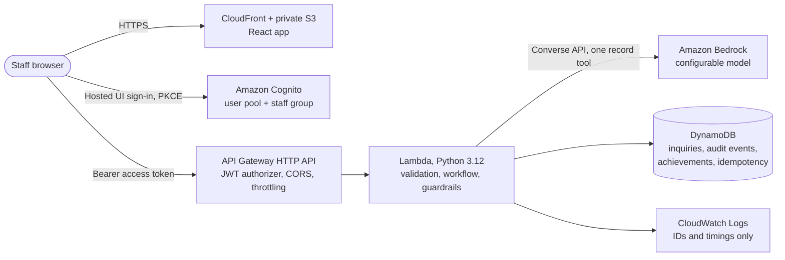
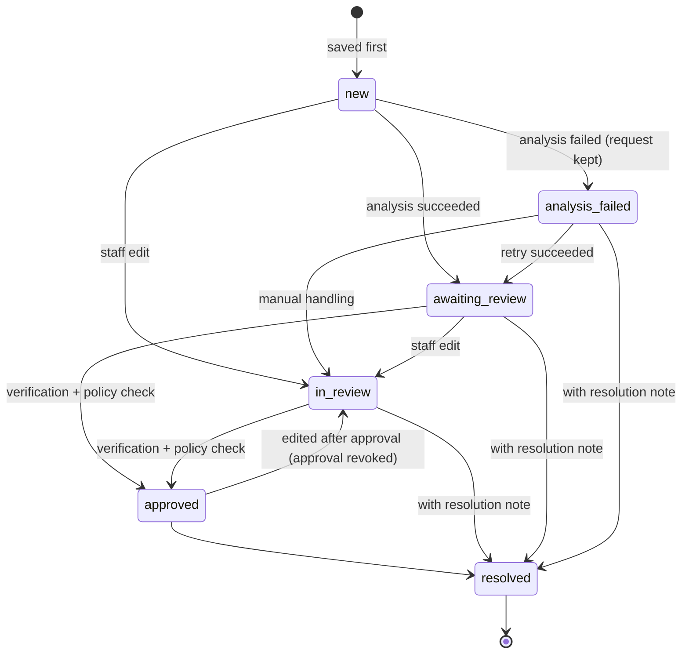

# LeadRescue architecture

## System diagram

## Inquiry lifecycle

## Security controls

| Risk | Control |
|---|---|
| Unauthenticated access | API Gateway JWT authorizer validates Cognito access tokens; Lambda also requires verified claims and the `staff` group. Only `/api/health` is public. |
| Cross-user practice data | Practice records live in `practice:<user id>`; the service checks ownership on every read and write. |
| Prompt injection | Customer text is wrapped in delimiters with tag neutralization; the system prompt declares it untrusted; the only tool records analysis and has no side effects; deterministic pattern detection forces manual review regardless of model output; approval is a staff-only API action with a checklist. |
| Invented facts | Grounding check removes any extracted value not present in the message or submitted contact fields. |
| Unsafe commitments | Server-side draft policy blocks approval of drafts that quote prices or confirm bookings, availability, guarantees, or free services. |
| Duplicate submissions | `Idempotency-Key` required on create, analyze, approve, resolve, and practice reset; responses replay; mismatched reuse returns 422. |
| Lost updates | `expectedVersion` optimistic locking with DynamoDB conditional transactions. |
| Data leakage in logs | Allow-listed structured log fields only; tests assert message text, drafts, emails, and tokens never reach logs. |
| Model errors | Mapped to staff-safe messages; raw provider errors are not shown; no fallback to simulated results. |
| Over-broad IAM | Per-table actions only (no Scan, no DeleteItem except idempotency); Bedrock limited to `InvokeModel` on the configured profile and a narrowable model ARN pattern. |
| Browser session theft | Tokens in sessionStorage only, 60-minute validity, no refresh token use, CloudFront security headers policy. |

## Data model (DynamoDB)

| Table | Keys | Contents |
|---|---|---|
| Inquiries | `id`; GSI `byWorkspace` (`workspace`, `createdAt`) | message, customer contact, status, staff fields, AI suggestion, approval, resolution, version |
| AuditEvents | `inquiryId`, `sk` = `<timestamp>#<time-ordered id>` | actor, type, details (no draft text) |
| Achievements | `userId`, `awardKey` (`XP#case#criterion`, `ACH#id`) | insert-once XP and achievement records |
| Idempotency | `key` (user + route + client key), TTL `expiresAt` | request fingerprint and stored response |

Inquiry updates and their audit events are written in one `TransactWriteItems` call.

## Analysis contract

Both providers return this object (validated against `MODEL_OUTPUT_SCHEMA` in `backend/src/leadrescue/analysis/contract.py`):

`category`, `priority`, `priorityReason`, `summary`, `extracted` (7 nullable fields), `missingInformation`, `draftReply`, `suspiciousInstructions`, `suspiciousReason`.

The service adds `guardrails` (removed fields, injection signals, overrides, policy warnings) and `meta` (provider, model, prompt version, latency, tokens, `confidenceCalibrated: false`). No confidence score is produced or displayed.

## Local development parity

`backend/local_server.py` converts HTTP requests into API Gateway v2 events and calls the same `lambda_handler` code. Demo sign-in issues HMAC-signed tokens with a per-process secret and injects claims exactly where the JWT authorizer would. The local JSON store implements the same conditional-write semantics as DynamoDB, and the DynamoDB store is integration-tested with moto.
